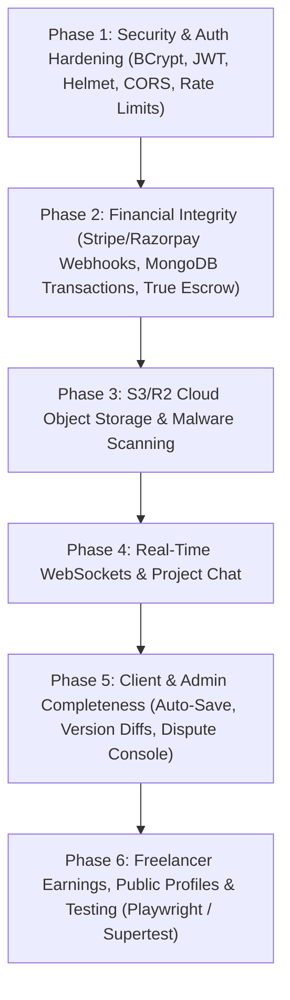

# NEXUSCRAFT VERSION 2.0 — REMAINING IMPLEMENTATION ROADMAP
**Document Type:** Phased Implementation Specification & Engineering Plan  
**Target:** 47 Unfinished / Proposed Catalogue Features (Excludes the 88 Verified Working Features)  
**Date:** November 16, 2026  
**Auditor / Architect:** Principal Full-Stack Software Auditor & Solutions Architect  

---

## 1. Security Architecture (Priority 1 — Immediate Next Step)

> [!CRITICAL]
> These items address fundamental security and credential safeguards that must be implemented before opening the platform to public users.

| Phase | Feature ID | Task & Requirement | Target Files | Dependencies |
|:---:|:---:|:---|:---|:---|
| **1.1** | **ID 3** | **BCrypt Password Hashing:** Install `bcryptjs`. Add a Mongoose pre-save hook to hash user passwords with salt cost 12. Replace plaintext string equality checks in `authRoutes.js` with `bcrypt.compare`. Add a migration script for existing seeded records. | `server/package.json`, `server/models/User.js`, `server/routes/authRoutes.js` | None |
| **1.2** | **ID 2, 10** | **JWT Access & Refresh Token Rotation:** Implement dual-token authentication. Return a 15-minute signed JWT in response headers/body and set a 7-day `httpOnly`, `SameSite=Strict`, `secure` refresh token cookie. Create `POST /api/auth/refresh` and `verifyToken` middleware. | `server/routes/authRoutes.js`, `server/middleware/auth.js`, `src/lib/api.ts` | `jsonwebtoken`, `cookie-parser` |
| **1.3** | **Checklist 1** | **Helmet & Content-Security-Policy:** Install `helmet`. Configure strict CSP allowing Google Gemini API, Unsplash avatars, and local asset bundles. | `server/index.js`, `server/package.json` | `helmet` |
| **1.4** | **Checklist 2** | **Strict CORS Allow-List:** Replace open `cors()` with an environment-driven origin whitelist (`http://localhost:5173`, production domains) with `credentials: true`. | `server/index.js` | None |
| **1.5** | **Checklist 3** | **Rate Limiting:** Install `express-rate-limit`. Apply 10 requests/15-min to `/api/auth/login` and `/api/auth/register`, and 20 requests/15-min to `/api/ai/*` and `/api/blueprints/generate`. | `server/index.js`, `server/routes/authRoutes.js`, `server/routes/aiAssistantRoutes.js` | `express-rate-limit` |
| **1.6** | **Checklist 4** | **Schema Validation (Zod):** Install `zod`. Create validation schemas for all registration, project submission, scope change, quotation, and deliverable upload routes. Reject malformed payloads with structured HTTP 400 errors. | `server/middleware/validate.js`, `server/schemas/*.js` | `zod` |

---

## 2. Financial Architecture & Escrow Isolation (Priority 2)

| Phase | Feature ID | Task & Requirement | Target Files | Dependencies |
|:---:|:---:|:---|:---|:---|
| **2.1** | **ID 8, 124** | **Verified Payment Gateway Integration:** Connect Stripe / Razorpay. In `POST /api/credits/topup`, generate a checkout session / order. Add an express raw-body webhook route (`POST /api/webhooks/stripe` or `/razorpay`) with cryptographic signature verification. Credit NCX tokens **only** on confirmed payment webhook events. | `server/routes/creditRoutes.js`, `server/routes/webhookRoutes.js`, `server/index.js` | Stripe / Razorpay API keys |
| **2.2** | **ID 25, 113** | **ACID Multi-Document Transactions:** Refactor the 50 NCX intake deduction, quote acceptance, and payout dispatches into `mongoose.startSession()` transaction blocks to guarantee zero partial-state failures. | `server/routes/projectRoutes.js`, `server/routes/creditRoutes.js` | MongoDB Replica Set |
| **2.3** | **ID 38, 75, 114** | **True Escrow Balance Isolation:** Update `User` model with `escrowBalance: { type: Number, default: 0 }`. When a milestone is funded, deduct from `credits` and add to `escrowBalance`. When handover is accepted, deduct `escrowBalance` and credit the specialist's wallet ledger. | `server/models/User.js`, `server/routes/deliverableRoutes.js`, `src/pages/client/ClientDashboardPage.tsx` | Schema migration |
| **2.4** | **ID 80** | **Dispute & Refund Reversal Engine:** Create an administrative refund workflow that reverses escrow reserves back to client `credits` with matching reversal ledger entries in `CreditTransaction`. | `server/routes/creditRoutes.js`, `src/pages/admin/AdminDashboardPage.tsx` | Phase 2.3 |

---

## 3. Storage & Deliverable Security (Priority 3)

| Phase | Feature ID | Task & Requirement | Target Files | Dependencies |
|:---:|:---:|:---|:---|:---|
| **3.1** | **ID 101, 72** | **S3 / R2 Object Storage Migration:** Replace local filesystem storage (`server/uploads/deliverables`) with AWS S3 or Cloudflare R2 bucket storage using `@aws-sdk/client-s3`. Serve client and admin downloads through signed, expiring URLs (15-minute TTL). | `server/routes/deliverableRoutes.js`, `server/routes/documentRoutes.js` | S3 / R2 Bucket & Credentials |
| **3.2** | **Checklist 12** | **Malware Scanning Worker:** Integrate ClamAV daemon or VirusTotal API scanning on newly uploaded ZIP buffers. Quarantine archives flagged with signatures prior to adding to the verified deliverable repository. | `server/routes/deliverableRoutes.js`, `server/services/malwareScanner.js` | ClamAV / VirusTotal key |

---

## 4. Real-Time Collaboration & Messaging (Priority 4)

| Phase | Feature ID | Task & Requirement | Target Files | Dependencies |
|:---:|:---:|:---|:---|:---|
| **4.1** | **ID 125** | **Socket.IO Real-Time Gateway:** Mount Socket.IO on the Express HTTP server in `server/index.js`. Emit events for `notification:received`, `blueprint:ready`, `deliverable:released`, and `radar:alert`. Add client socket provider in React. | `server/index.js`, `src/context/SocketContext.tsx`, `src/components/AppShell.tsx` | `socket.io`, `socket.io-client` |
| **4.2** | **ID 127** | **In-App Project Chat:** Implement `ChatMessage` Mongoose model (`projectId`, `senderId`, `senderRole`, `message`, `attachments`, `createdAt`). Connect real-time socket messaging channel and render a floating chat widget in active project workspaces. | `server/models/ChatMessage.js`, `server/routes/chatRoutes.js`, `src/components/shared/ProjectChatDrawer.tsx` | Phase 4.1 |
| **4.3** | **ID 126** | **Transactional Email Service:** Integrate Resend or SendGrid. Create clean HTML email templates for welcome bonus, AI blueprint completion, specialist assignment, and deliverable handover acceptance. | `server/services/emailService.js`, `server/templates/` | Resend / SendGrid API key |

---

## 5. Client Portal Completeness (Priority 5)

| Phase | Feature ID | Task & Requirement | Target Files | Dependencies |
|:---:|:---:|:---|:---|:---|
| **5.1** | **ID 16** | **Idea Vault Auto-Save:** Implement debounced auto-save hook (`useDebounce`) in `ClientDashboardPage.tsx` that commits draft edits automatically after 1,500ms of inactivity with a visible "Saved to Vault" indicator. | `src/pages/client/ClientDashboardPage.tsx` | None |
| **5.2** | **ID 18** | **Draft Feasibility Pre-Score:** Add `feasibilityScore` field to `IdeaDraftSchema`. Compute a preliminary 1-100 score based on title clarity, category, budget alignment, and timeline feasibility when a draft is saved. | `server/models/IdeaDraft.js`, `server/routes/draftRoutes.js`, `ClientDashboardPage.tsx` | None |
| **5.3** | **ID 20, 21, 23** | **Dedicated AI Persona, Monetisation & Competitor Tools:** Add explicit cases (`persona_generator`, `monetization_architect`, `competitive_intelligence`) in `server/routes/aiAssistantRoutes.js` and expose them in the Client Dashboard AI selector. | `server/routes/aiAssistantRoutes.js`, `ClientDashboardPage.tsx` | None |
| **5.4** | **ID 47** | **Blueprint Version Diff Viewer:** Create a `ProjectBlueprintVersion` history model. When a blueprint is revised, archive the previous snapshot and provide a side-by-side visual diff in the Blueprint Studio. | `server/models/ProjectBlueprintVersion.js`, `server/routes/blueprintRoutes.js`, `ClientDashboardPage.tsx` | None |
| **5.5** | **ID 48** | **Export Blueprint to PDF and Word:** Add client-side or server-side PDF generator (using `jspdf` or Puppeteer) and DOCX generator for the 17-section technical blueprint. | `src/lib/pdfExport.ts`, `ClientDashboardPage.tsx` | `jspdf` / `html2canvas` |
| **5.6** | **ID 51** | **Shareable Read-Only Blueprint Secret Links:** Generate random tokenized URLs (`/blueprint/share/:secretToken`) enabling co-founders and investors to inspect the active project blueprint without logging in. | `server/routes/blueprintRoutes.js`, `src/App.tsx`, `src/pages/public/PublicBlueprintViewer.tsx` | None |
| **5.7** | **ID 52** | **Multi-Tenant Team Invitations:** Create `Team` schema. Enable client account owners to invite collaborators with `Owner`, `Approver`, or `Viewer` permissions. | `server/models/Team.js`, `server/routes/teamRoutes.js`, `src/pages/SettingsPage.tsx` | Email service (Phase 4.3) |

---

## 6. Admin Portal Completeness (Priority 6)

| Phase | Feature ID | Task & Requirement | Target Files | Dependencies |
|:---:|:---:|:---|:---|:---|
| **6.1** | **ID 78** | **AI Specialist Recommendation Engine:** When an admin reviews an approved project, query the Gemini API with project tech stack and match against the top 3 specialists in `User` roster based on skills, capacity, and feedback ratings. | `server/routes/freelancerRoutes.js`, `src/pages/admin/AdminDashboardPage.tsx` | None |
| **6.2** | **ID 79** | **Dispute Mediation Console:** Implement `Dispute` model. Provide an administrative arbitration interface to review client claims, inspect specialist worklogs, and issue binding resolutions. | `server/models/Dispute.js`, `server/routes/disputeRoutes.js`, `src/pages/admin/AdminDashboardPage.tsx` | None |
| **6.3** | **ID 82** | **Bulk Pipeline Operations:** Add selection checkboxes to the intake table in `AdminDashboardPage.tsx` with bulk "Approve for Scoping", "Assign Category", or "Reject" actions. | `src/pages/admin/AdminDashboardPage.tsx` | None |
| **6.4** | **ID 83** | **CSV & PDF Financial Exports:** Add export utilities in `AdminDashboardPage.tsx` to download transaction ledgers, gross margin breakdowns, and platform commission reports. | `src/lib/csvExport.ts`, `src/pages/admin/AdminDashboardPage.tsx` | None |
| **6.5** | **ID 85, 86** | **Configurable SLA & Platform Settings:** Create `PlatformSetting` model. Provide an admin UI to adjust SLA breach hours, token pricing, commission percentages, and feature flags without code modifications. | `server/models/PlatformSetting.js`, `server/routes/settingRoutes.js`, `src/pages/admin/AdminDashboardPage.tsx` | None |

---

## 7. Freelancer Portal Completeness (Priority 7)

| Phase | Feature ID | Task & Requirement | Target Files | Dependencies |
|:---:|:---:|:---|:---|:---|
| **7.1** | **ID 108** | **Availability Calendar & Vacation Mode:** Add an interactive calendar in `FreelancerDashboardPage.tsx` allowing specialists to mark blackout vacation dates and set daily working capacity. | `server/routes/freelancerRoutes.js`, `src/pages/freelancer/FreelancerDashboardPage.tsx` | None |
| **7.2** | **ID 109** | **Live Stopwatch Timer:** Add active start, pause, and stop stopwatch controls to `EffortTrackerModal.tsx` that increments elapsed time and automatically populates the logged effort field. | `src/components/freelancer/EffortTrackerModal.tsx` | None |
| **7.3** | **ID 110, 111** | **Earnings Dashboard & Invoices:** Create a dedicated specialist earnings tab showing historical milestone releases, pending escrow, bank withdrawal options, and downloadable PDF tax invoices. | `server/routes/freelancerRoutes.js`, `src/pages/freelancer/FreelancerDashboardPage.tsx` | None |
| **7.4** | **ID 107, 112** | **Public Specialist Profiles & Badges:** Build `/specialists/:id` public showcase showing verified skill badges, rating scores, completed delivery statistics, and sample non-confidential deliverables. | `src/pages/public/PublicSpecialistProfilePage.tsx`, `src/App.tsx` | None |

---

## 8. SEO, Public Content & Infrastructure (Priority 8)

| Phase | Feature ID | Task & Requirement | Target Files | Dependencies |
|:---:|:---:|:---|:---|:---|
| **8.1** | **Section 3.1** | **About, Contact & Blog Public Pages:** Create `AboutPage.tsx`, `ContactUsPage.tsx`, and `BlogPage.tsx` under `src/pages/public/`. Register routes in `src/App.tsx`. | `src/pages/public/AboutPage.tsx`, `src/pages/public/ContactUsPage.tsx`, `src/pages/public/BlogPage.tsx`, `src/App.tsx` | None |
| **8.2** | **Section 3.2** | **Sitemap & Robots.txt:** Create `public/robots.txt` and `public/sitemap.xml` mapping all public marketing and educational routes for search engine indexing. | `public/robots.txt`, `public/sitemap.xml` | None |
| **8.3** | **Checklist 10** | **Automated Integration & E2E Test Suite:** Install `supertest` for Express API integration testing and `@playwright/test` for browser end-to-end testing covering registration, project intake, and deliverable handover. | `tests/api.test.mjs`, `tests/e2e/`, `package.json` | `supertest`, `@playwright/test` |
| **8.4** | **ID 134** | **Background Job Queue:** Install `bullmq` and connect Redis for asynchronous handling of heavy background jobs (Gemini blueprint generation, ZIP hashing, and email dispatches). | `server/queues/`, `server/workers/` | Redis instance |
| **8.5** | **ID 135** | **Progressive Web App (PWA):** Add `manifest.json`, high-resolution app icons, and configure a basic service worker for offline asset caching. | `public/manifest.json`, `index.html` | None |

---

## 9. Recommended Execution Sequence

